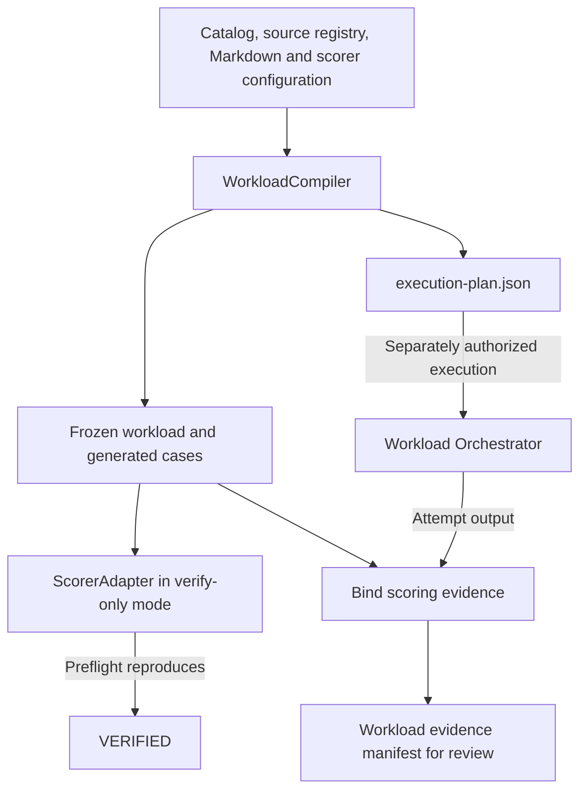

# AF Workloads

Adventure Finder Workloads (AFW) turns selected adventures and scoring dimensions
into frozen cases and an execution plan for [Workload Orchestrator (WLO)](https://github.com/dtnorris/workload-orchestrator).

**Using AFW with your own library?** Clone this public `af-workloads` repository
for the tools. Create a private companion repository named `af-workloads-data`
in your own account or organization for workload manifests, execution plans,
generated cases, and scoring evidence. Pass the path to its checkout as
`--data-root`. For a local trial, you can use an existing writable directory
outside the code checkout. See [Adventure Finder’s private repository setup](https://github.com/dtnorris/adventure-finder#set-up-your-own-private-repositories).

## How AF Workloads works

The public example ends at `VERIFIED`: AFW reproduced scorer preflight from
the frozen inputs. You can reach this point before pulling a model. Live
scoring requires separate qualification for this public method. Until then,
the adapter refuses to execute it. For a qualified and authorized run, WLO
records the attempt and AFW binds its results to the frozen workload.

## Setup

Use Ruby 4.0, Bundler 4.0.17 and Git. From this distribution run
`BUNDLE_FROZEN=true bundle install`. Prepare these separately owned inputs:

- [AF Scorer](https://github.com/dtnorris/af-scorer) at
  `fdd620850b24a5b801eb68391ca3e98c22d4b28a`.
- [AF Specification](https://github.com/dtnorris/af-specification-md) at
  `394a44c2c2052ce2eeb6d28cd7647ad8a50acfcf`.
- A catalog workbook, a source registry, and the source files it names.
- A separate writable data root, selected explicitly with `--data-root` even
  when it is the current directory. AFW writes manifests and plans under
  `workloads/`, generated cases under `build/workloads/`, and results and
  evidence under `output/workloads/`.

**Compile and verify offline.** Follow the [operator runbook](docs/operator-runbook.md)
with the inputs above and an explicit scorer configuration. Compilation writes
a frozen workload and `execution-plan.json` beneath your AFW data root.
Verify-only replay prints `VERIFIED` when the case reproduces. These steps run
before model acquisition. To explore the scorer on its own, use its
[standalone offline walkthrough](https://github.com/dtnorris/af-scorer/blob/278aa45042d09366b130f169bcf940c8202acc03/README.md#offline-first-operation).

**Pulling models for scoring.** Find your model in [the model registry](config/models.yml)
and run `ollama pull <pull_model>`, including the publisher prefix when listed.
Before scoring, check the pulled model's full `digest` in Ollama's
[`GET /api/tags` response](https://docs.ollama.com/api/tags) against
`qualified_manifest_sha256`. Continue only on an exact match. If the tag moves
or disappears, search for the first 12 characters of the pinned digest to find
another tag, then verify the full digest again.

## Guides

| Reader question | Guide |
| --- | --- |
| How do I compile a workload and verify a case offline? | [Operator runbook](docs/operator-runbook.md) |
| Where are the plan, cases, and results stored? When can I reuse or regenerate a workload? | [Workload layout, inspection, and recovery](docs/AFW_FORWARD_WORKLOADS.md) |
| Why did replay refuse a case after an input changed? | [Frozen input identities](docs/frozen-input-identities.md) |
| Which settings are frozen into a job, and who chooses the Ollama endpoint? | [Scorer environment and worker placement](docs/scorer-environment.md) |
| Which model and settings does the Exploration Emphasis example use, and what is qualified? | [Exploration Emphasis profile](docs/MDL-01_EE_ADOPTION.md) |

## Validate

Run `.buildkite/test.sh` from the repository after setup. Set
`AFW_TEST_SCORER_ROOT` and `AFW_TEST_SPEC_ROOT` to clean checkouts at the
pins above to run with locally available inputs. With neither set the script
obtains both pins from their public repositories. Buildkite uses the same
entry point and locked Ruby dependencies.

The MIT license and [notices](THIRD_PARTY_NOTICES.md) accompany this code.
